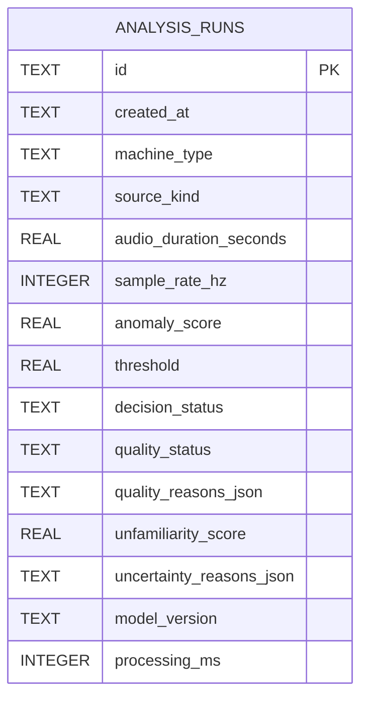

# Database Schema & Metadata Audit Trail

## 1. Storage strategy: Embedded SQLite Audit Store

In accordance with Milestone M6 and the CloudCamp BD Data Lifecycle standards, PulseForge AI implements an embedded **SQLite metadata audit store** (`src/persistence.py`).

Key architectural principles:
- **Zero Configuration:** Embedded local database (`data/analysis_history.db`), requiring zero database server setup.
- **Privacy & Safety:** Strictly persists **analysis metadata, scores, and timestamps only**. Raw audio is never persisted.
- **Unified Interface:** Used by the central service (`src/service.py`) and rendered in View 4 of the Streamlit dashboard (`Inspection History & Audit`).
- **CSV Export:** Includes 1-click CSV export functionality for regulatory compliance and ISO 13374 auditing.

## 2. Table: `analysis_runs`

| Column | Type | Required | Description |
|---|---|---:|---|
| `id` | TEXT | Yes | UUID primary key |
| `created_at` | TEXT | Yes | UTC ISO-8601 timestamp |
| `machine_type` | TEXT | Yes | Machine family (`fan`, `pump`, `valve`, `slider`) |
| `machine_id` | TEXT | Yes | Specific machine ID (e.g. `fan_id_00`) |
| `input_label` | TEXT | No | Sanitized display label (e.g. `01_normal_fan.wav`) |
| `source_kind` | TEXT | Yes | `uploaded`, `demo_sample`, or `synthetic` |
| `audio_duration_seconds` | REAL | Yes | Decoded audio length in seconds |
| `sample_rate_hz` | INTEGER | Yes | Standardized sample rate (16,000 Hz) |
| `anomaly_score` | REAL | Yes | Autoencoder reconstruction MSE error |
| `threshold` | REAL | Yes | Calibrated validation threshold |
| `decision_status` | TEXT | Yes | `normal`, `possible_anomaly`, `needs_review`, `invalid_input` |
| `quality_status` | TEXT | Yes | `good`, `warning`, or `poor` |
| `quality_reasons_json` | TEXT | No | JSON array of signal quality flags |
| `unfamiliarity_score` | REAL | No | Latent Mahalanobis distance |
| `uncertainty_reasons_json` | TEXT | No | JSON array of unfamiliarity flags |
| `model_version` | TEXT | Yes | Model artifact identifier |
| `processing_ms` | INTEGER | No | Inference CPU latency in milliseconds |
| `operator_note` | TEXT | No | Optional operator note or technician comment |

### SQL schema (Implemented in `src/persistence.py`)

```sql
CREATE TABLE IF NOT EXISTS analysis_runs (
    id TEXT PRIMARY KEY,
    created_at TEXT NOT NULL,
    machine_type TEXT NOT NULL CHECK (machine_type IN ('fan', 'pump', 'valve', 'slider')),
    machine_id TEXT NOT NULL,
    input_label TEXT,
    source_kind TEXT NOT NULL CHECK (source_kind IN ('uploaded', 'demo_sample', 'synthetic')),
    audio_duration_seconds REAL NOT NULL,
    sample_rate_hz INTEGER NOT NULL,
    anomaly_score REAL NOT NULL,
    threshold REAL NOT NULL,
    decision_status TEXT NOT NULL CHECK (
        decision_status IN ('normal', 'possible_anomaly', 'needs_review', 'invalid_input')
    ),
    quality_status TEXT NOT NULL,
    quality_reasons_json TEXT,
    unfamiliarity_score REAL,
    uncertainty_reasons_json TEXT,
    model_version TEXT NOT NULL,
    processing_ms INTEGER,
    operator_note TEXT
);

CREATE INDEX IF NOT EXISTS idx_analysis_runs_created_at
ON analysis_runs(created_at DESC);

CREATE INDEX IF NOT EXISTS idx_analysis_runs_machine_id
ON analysis_runs(machine_id);
```
```

## 3. ER diagram

There are no user/account tables in the MVP. If metadata history is enabled, the minimal model is one analysis record per run:



## 4. Data retention and privacy

- Default: no raw audio persistence.
- Uploaded bytes should be held in memory or a generated temporary file and removed after analysis.
- If the operator explicitly exports an audio file, that is a separate user action and must be explained.
- Retain only metadata that is useful for demo history and evaluation.
- Do not log full local paths or raw uploaded data.
- A public/multi-user deployment requires an approved data-retention policy and access control.

## 5. Model artifacts are not database rows

Keep model checkpoints, preprocessing config, threshold, and metrics as versioned files under a local `models/` or `model_artifacts/` directory. Do not store large weight tensors in SQLite.
