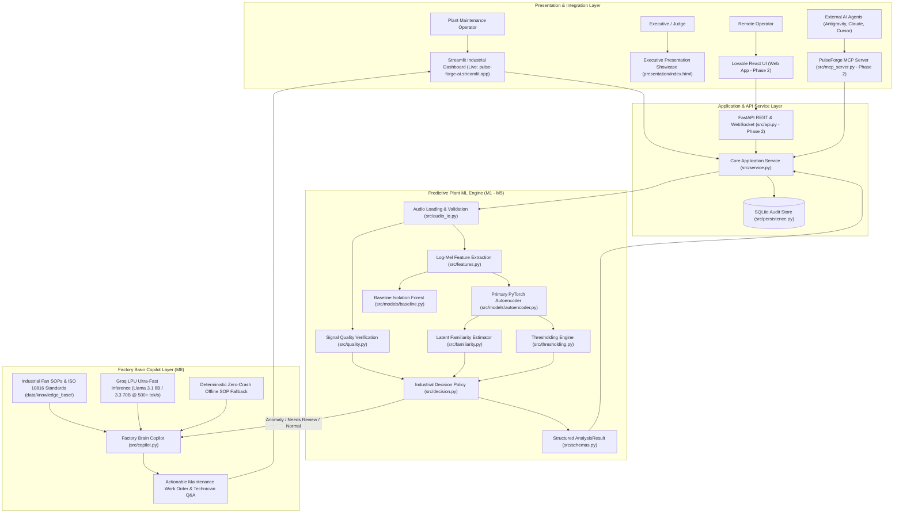
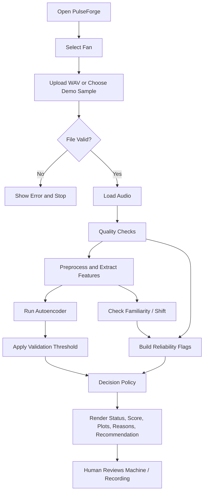
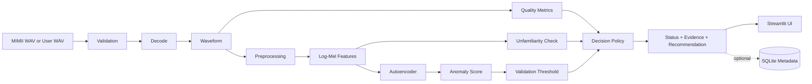

# System Architecture

## 1. Architecture strategy: Layered Industrial AI Platform

PulseForge AI uses a **modular layered architecture** balancing two critical requirements:
1. **Scientific Acoustic Integrity (Predictive Plant):** The core audio feature pipeline, PyTorch Autoencoder, signal quality checks, latent familiarity estimator, and 4-state decision policy remain 100% deterministic and physics-grounded.
2. **CloudCamp BD Hackathon Excellence:** Layered around this core engine are an application service layer, SQLite audit logging, a FastAPI adapter powering dual frontends (Streamlit + Lovable React), a custom Model Context Protocol (MCP) server, an agentic Factory Brain copilot with local Ollama/RAG integration, and Cloudflare Tunneling for live public judging.

## 2. Logical architecture

## 3. Component responsibilities

| Component | Responsibility | Input | Output |
|---|---|---|---|
| Streamlit dashboard | Collect machine selection and WAV; present progress and results | User actions | Application service calls and rendered result |
| Upload validator | Validate size, extension, format, decode, duration, channel count | Uploaded bytes / file handle | Safe audio object or validation error |
| Audio I/O | Decode using SoundFile/Librosa, retain sample rate/channels metadata | WAV | Waveform array and metadata |
| Preprocessor | Normalize sample rate, channels, segment length, and scaling consistently | Waveform | Model-ready signal |
| Feature extractor | Compute log-Mel or selected feature representation | Preprocessed signal | Feature tensor / feature summary |
| Autoencoder | Reconstruct normal acoustic features | Feature tensor | Reconstruction and anomaly score |
| Baseline | Provide benchmark detector | Aggregated features | Baseline score / prediction |
| Quality checker | Evaluate duration, silence, clipping, and configurable checks | Raw/preprocessed signal | Quality status and reasons |
| Familiarity checker | Compare feature / embedding representation with training distribution | Features or embedding | Familiarity flag / distance |
| Decision policy | Combine model score with quality and familiarity flags | Scores and flags | `normal`, `possible_anomaly`, `needs_review`, or `invalid_input` |
| Explanation builder | Convert measurable signals into cautious text | Result fields | Evidence summary and recommendation |
| Persistence Store | Store analysis metadata, scores, and decisions in SQLite; support CSV export | Result metadata | Run ID and audit history |
| Factory Brain Copilot | Generate OSHA LOTO work orders and answer technician queries via Groq LPU / SOP fallback | Telemetry + SOP docs | Work order JSON/Markdown & Q&A |
| Presentation Showcase | Executive web showcase with vector machinery blueprint & spectrogram comparison | Browser request | High-level interactive keynote UX |

## 4. Application workflow

## 5. Decision policy

Use separate values for anomaly detection and reliability. A proposed initial status policy:

1. **Invalid input:** unable to safely decode or fails mandatory file constraints. Stop before inference.
2. **Needs review:** recording fails an essential quality check or is sufficiently unfamiliar that the model result should not be interpreted as a reliable normal/anomaly decision.
3. **Possible anomaly:** input passes quality checks and anomaly score exceeds the validation-derived threshold. If there is also a mild unfamiliarity flag, show both the anomaly and the review warning prominently.
4. **Normal:** input passes quality checks, no severe unfamiliarity flag is present, and score is below threshold.

Exact thresholds and precedence must be written in tests and model metadata. Do not blend signal quality into the anomaly score without a separately validated method.

## 6. Data flow

## 7. Data / model lifecycle

### Offline training path

1. Inspect and inventory selected MIMII fan files.
2. Build a CSV manifest with file ID, relative path, machine/model section, label, noise condition, recording group, and split.
3. Create leakage-aware train / validation / test partitions.
4. Fit feature normalization on training data only.
5. Train Autoencoder on normal training samples.
6. Select anomaly threshold using validation data and a declared operating criterion.
7. Fit or configure unfamiliarity detector using training/validation data only.
8. Evaluate once on held-out test data.
9. Save checkpoint, preprocessing config, threshold, training metadata, and metrics.

### Online inference path

1. Load validated model artifact/config.
2. Decode and validate uploaded audio.
3. Apply exactly the same preprocessing and feature transformation as training.
4. Compute anomaly score and independent reliability flags.
5. Apply decision policy.
6. Render result and optionally persist metadata.

## 8. Component interaction contract

The core application service should expose one reusable function, conceptually:

`analyze_audio(audio_bytes, filename, model_bundle, config) -> AnalysisResult`

It should not depend on Streamlit or FastAPI. It should:

- validate and decode;
- preprocess and extract features;
- run detector(s);
- calculate quality / familiarity flags;
- apply decision rules;
- return a typed result or a typed validation error.

Streamlit calls this directly in the MVP. FastAPI, if added, calls the same service.

## 9. Deployment architecture

### MVP

- Local laptop or hackathon workstation.
- Streamlit process.
- Local model artifact and configuration.
- Local demo audio and dataset (not served for download).
- No required internet access after setup.

### Optional later deployment

A small server can host Streamlit or FastAPI behind HTTPS and authentication. Before public access, introduce access control, request/file limits, secure temporary storage, logging policy, and retention controls. No production deployment is claimed by this package.

## 10. Scalability and performance notes

- Use chunked / windowed inference if recordings exceed model input length.
- Batch segments carefully to avoid memory spikes.
- Limit file size and duration.
- Cache model loading and immutable assets, not user-specific results across users.
- Keep CPU fallback working; GPU is optional.
- Measure processing latency on the actual demo machine rather than promising a fixed time.
- For additional machine types, train and validate a distinct model/config per type or supported machine family. Do not reuse fan thresholds blindly.

## 11. Logging and error handling

Log timestamps, app version, model version, stage, duration, and sanitized error categories. Avoid logging raw audio, secrets, or unnecessary personally identifiable information.

Expected error categories:

- unsupported file type;
- oversized file;
- corrupt / undecodable WAV;
- too short / silent / clipped input;
- model artifact missing or incompatible;
- feature extraction failure;
- inference failure;
- optional persistence failure.

Show a helpful message to the user and preserve technical stack traces in local developer logs only.
